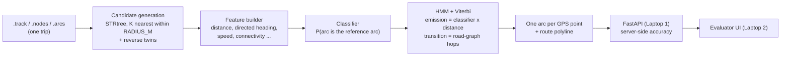
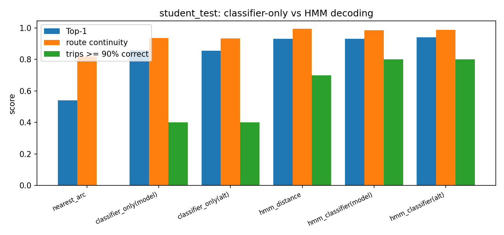
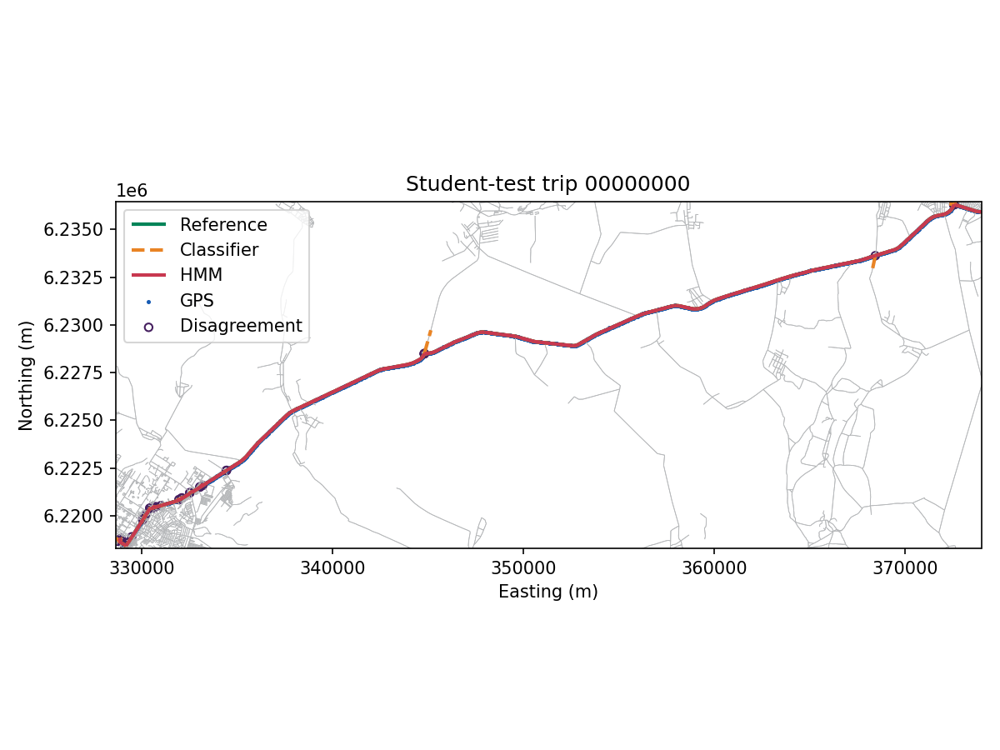

<div align="center">

# PathSnap

### Distributed map-matching and route reconstruction from noisy GPS

*Candidate arcs &rarr; classifier &rarr; HMM / Viterbi &rarr; FastAPI on Laptop 1 &rarr; evaluator UI on Laptop 2*

UE24CS352A · Machine Learning · PES University

</div>

---

## Team
| # | SRN | Name |
|---|-----|------|
| 1 | PES2UG24CS474 | Shivansh Sharma |
| 2 | PES2UG24CS478| Shreelakshmi G Bhat |
| 3 | PES2UG24CS922 | Vikas Kulakarni |
| 4 | PES2UG24CS455 | Sham Santhosh S  |

---

## The problem in one minute

A vehicle drives along a road, but its GPS fixes wobble: they land on the wrong side of a building, jump to a
parallel street or drift when the signal is poor. Given the noisy fixes of a trip (`.track`) and the road network of that
trip (`.nodes`, `.arcs`), PathSnap must say **which road segment (arc) every single GPS point is on**, and the chosen arcs must
form a realistic, connected route.

Three things make this harder than "pick the nearest road":

1. **Every trip has its own road network** (checked in `results/eda/network_check.txt`), so a model cannot memorise arc ids.
2. **Roads are directed and two-way roads appear twice.** Most arcs have a *reverse twin* with identical geometry (the share is
   in `results/eda/network_check.txt`), so distance alone is a coin flip between the two directions. Direction has to come from the GPS heading.
3. **Independent decisions break the route.** Choosing the best arc point by point produces jumps between unconnected roads.
   A sequence model that knows the road graph is needed.

## Our solution



| Stage | What it does | Key idea |
|---|---|---|
| **Labels** | Turns `.route` into one reference arc per GPS point | Monotone dynamic programme: the route index may only stay or move forward, minimising total distance |
| **Candidates** | Up to K arcs near each point | STRtree in a per-trip UTM projection (metres); the reverse twin of every kept arc is kept too; fallback when nothing is in range |
| **Features** | the numeric inputs listed in `FEATURE_COLUMNS` per (point, arc) | Directed `heading_diff` (0-180 deg) separates an arc from its twin; `connects_prev_best` injects road connectivity |
| **Models** | Five families compared with trip-grouped CV | Logistic regression, Gaussian NB, decision tree, random forest, histogram gradient boosting |
| **Bayesian tuning** | Optuna TPE on the best model | Objective: observation-level Top-1 under GroupKFold by trip |
| **HMM** | Viterbi over candidate arcs per point | Emission mixes classifier probability and a Gaussian on distance; transitions follow directed road hops with an epsilon floor so the path never dies |
| **API + UI** | Two-laptop deployment | Prediction first, labels read only afterwards and only two numbers returned |

## Results

All numbers below are produced by code and loaded from `results/*.csv`. Regenerate this block with
`python scripts/update_readme_tables.py`. Partition: **student_test** (10 trips) unless stated.

<!-- RESULTS:START -->
**Route decoding** (`results/hmm_results.csv`; reference labels from `data_processing/label_points.py`):

| Method | Top-1 | Macro F1 | Route continuity | Wrong direction | Trips >= 90% correct |
|---|---|---|---|---|---|
| nearest_arc | 0.540 | 0.723 | 0.820 | 0.351 | 0% |
| classifier_only(model) | 0.859 | 0.918 | 0.937 | 0.066 | 40% |
| classifier_only(alt) | 0.856 | 0.916 | 0.932 | 0.065 | 40% |
| hmm_distance | 0.930 | 0.960 | 0.995 | 0.028 | 70% |
| hmm_classifier(model) | 0.931 | 0.961 | 0.985 | 0.036 | 80% |
| hmm_classifier(alt) | 0.939 | 0.966 | 0.987 | 0.024 | 80% |

**Model comparison** (`results/model_comparison.csv`; CV = 5-fold GroupKFold by trip on the 80 train trips):

| Model | Family | CV Top-1 | CV macro F1 | Student Top-1 | Student macro F1 | Student log loss | Route continuity |
|---|---|---|---|---|---|---|---|
| hist_gradient_boosting | Boosting | 0.743 | 0.889 | 0.856 | 0.916 | 0.109 | 0.936 |
| random_forest | Ensemble (bagging) | 0.743 | 0.888 | 0.856 | 0.915 | 0.110 | 0.932 |
| decision_tree | Tree-based | 0.741 | 0.875 | 0.852 | 0.915 | 0.113 | 0.934 |
| logistic_regression | Linear / probabilistic | 0.731 | 0.848 | 0.842 | 0.893 | 0.170 | 0.926 |
| gaussian_naive_bayes | Probabilistic (generative) | 0.717 | 0.788 | 0.819 | 0.795 | 0.484 | 0.942 |

**Bayesian tuning** (`results/tuning_comparison.csv`; same folds and partitions for both rows):

| Model | Configuration | CV Top-1 | CV macro F1 | Student Top-1 | Student macro F1 | Log loss |
|---|---|---|---|---|---|---|
| hist_gradient_boosting | untuned | 0.7432 | 0.8889 | 0.8563 | 0.9163 | 0.1092 |
| hist_gradient_boosting | tuned (Optuna TPE) | 0.7443 | 0.8888 | 0.8586 | 0.9173 | 0.1075 |

**Candidate miss rate** (reference arc absent from the candidates; `results/eda/candidate_miss_by_trip.csv`):

| Partition | Candidate miss rate |
|---|---|
| train, all 80 trips | 0.0790 |
| train, 73 trips with reliable labels | 0.0055 |
| train, 7 flagged trips | 0.2682 |
| student_test (10 trips) | 0.0037 |
<!-- RESULTS:END -->

<p align="center">
  <br>
  <em>Classifier-only vs HMM decoding on student_test.</em>
</p>

<p align="center">
  <br>
  <em>One student_test trip: reference route (green), classifier-only (orange, dashed), HMM (red), GPS (blue). Interactive versions with layer controls are in <code>visualisations/maps/</code>.</em>
</p>

## Quick start

Python 3.10+ (developed on 3.11). Windows PowerShell shown; replace `.\scripts\*.ps1` with the `python -m ...` commands elsewhere.

```powershell
python -m venv .venv ; .\.venv\Scripts\Activate.ps1
python -m pip install -r requirements.txt
python -m pytest -q                                   # unit, API and UI-contract tests

# Laptop 1 (API). -Rehearse serves the student_test trips until data/eval_test/ is available.
.\scripts\start_api.ps1 -Rehearse                     # http://<laptop-1-ip>:8000   (docs: /docs)

# Laptop 2 (UI), pointing at Laptop 1
.\scripts\start_ui.ps1 -Api http://<laptop-1-ip>:8000 # http://127.0.0.1:8501
```

Open the UI, press **Connect & load trips**, pick a trip, press **Reconstruct route**. Laptop 1 prints one log line per request:

```
<time> | <client ip> | POST /predict | <trip id> | 200 | n=<points> | acc=<accuracy> | <latency> ms
```

Find the LAN address with `ipconfig` (Windows), `ipconfig getifaddr en0` (macOS) or `hostname -I` (Linux), allow TCP port 8000 through the
firewall, and keep both laptops on the same network (a phone hotspot works if the campus Wi-Fi isolates clients).

### API reference

| Endpoint | Purpose | Response |
|---|---|---|
| `GET /health` | liveness | `{"status": "ok"}` |
| `GET /trips` | ids of the evaluation trips (folder `data/eval_test/`) | `["...", "..."]` |
| `POST /predict` `{"trip_id": "..."}` | predict one trip | `trip_id, n_points, points[{point_idx, lon, lat, arc_id}], route_coords, accuracy, route_continuity, latency_ms, model_version` |

The server predicts first; only afterwards `api/evaluation.py` reads the held-out route and returns **two numbers**
(accuracy, route continuity). Reference arcs and the reference route never appear in any response.

## Reproduce everything

```powershell
python -m data_processing.inspect_network                            # results/eda/network_check.txt
python -m visualisations.eda_plots                                   # EDA tables and figures -> results/eda/
python -m data_processing.label_points --splits train student_test  # results/eda/label_quality.csv
python -m features.candidate_sweep                                   # results/eda/candidate_sweep.csv
python -m features.make_tables --splits train student_test           # data/processed/*_features.parquet
python -m features.miss_report                                       # results/eda/candidate_miss_by_trip.csv
python -m models.train_models                                        # results/model_comparison.csv, out-of-fold probabilities
python -m optimisation.bayes_tune                                    # artifacts/model*.joblib, results/optuna_trials.csv
python -m hmm.tune ; python -m hmm.tune --baseline                   # decoder tuning on train OOF probabilities
python -m hmm.evaluate                                               # results/hmm_results.csv, hmm_failures.csv
python -m models.diagnostics ; python -m models.ablation_trips       # confusion matrices, importance, training with vs without the flagged trips
python -m hmm.pipeline --split student_test --save                   # results/predictions/
python -m visualisations.plot_prediction                             # Folium comparison maps
python -m api.smoke_test --url http://localhost:8000                 # crash test over every served trip
python scripts/build_notebooks.py                                    # re-execute the notebooks
python scripts/update_readme_tables.py                               # refresh the tables above
```

Seeds are fixed (`SEED = 42` in `common/config.py`); cross-validation is `GroupKFold` by trip.

## Notebooks

| Notebook | Content |
|---|---|
| [`01_eda`](notebooks/01_eda.ipynb) | inventory, missing values, time gaps, network connectivity, GPS noise, Folium map, data-quality record |
| [`02_labels_and_features`](notebooks/02_labels_and_features.ipynb) | monotone-DP labelling, candidate sweep, feature definitions, permutation importance |
| [`03_model_comparison`](notebooks/03_model_comparison.ipynb) | five model families, CV vs student_test, confusion matrices, calibration, 80-vs-73-trips ablation |
| [`04_bayesian_optimisation`](notebooks/04_bayesian_optimisation.ipynb) | Optuna TPE search record, tuned vs untuned |
| [`05_hmm_route_reconstruction`](notebooks/05_hmm_route_reconstruction.ipynb) | hand-checked Viterbi, transition model, decoder tuning, classifier-only vs HMM, failures |
| [`06_api_and_ui`](notebooks/06_api_and_ui.ipynb) | in-process API run, request log, proof that labels stay server-side |

Notebooks only call project modules and load saved results, so they never contain typed-in numbers.

## Repository layout

```
common/            config (paths, SEED, K, RADIUS_M), loaders, geometry (UTM, distances, bearing)
data_processing/   network check, monotone-DP reference labels
features/          candidates (STRtree), feature builder, labelled tables, K x radius sweep, miss report
models/            five-model training, diagnostics, ablation
optimisation/      Optuna TPE hyperparameter search
hmm/               road graph, Viterbi, emission/transition, decoder tuning, evaluation, Predictor
api/               FastAPI service, server-side evaluation, smoke test
ui/                evaluator interface (Laptop 2)
visualisations/    EDA plots, Folium maps
notebooks/         six executed notebooks
artifacts/         model.joblib, model_alt.joblib, feature_list.json, hmm_config*.json, best_params.json
results/           every reported table and figure (eda/, figures/, predictions/, *.csv)
docs/              methodology, design decisions and limitations
report/            technical report, generator, rehearsal results, guide and screenshots
scripts/           demo start scripts, notebook builder, README table updater
tests/             unit, API, pipeline and UI-contract tests
```

Raw data lives in `data/{train,student_test,eval_test}/<trip>/` and is not committed.

## Submission checklist
The [technical report](report/PathSnap_Report.pdf) uses the deployed artifacts and active results. [Rehearsal results](report/rehearsal.csv) and the [receiving-server log](report/rehearsal.log) cover all ten student-test trips through the running API from a client on one host (`python -m report.rehearse`; browser screenshots come from the real two-laptop run). Use scikit-learn 1.7.0 to load the published joblib model.

For the physical demo, start the API on Laptop 1, serve student_test for rehearsal, and run the UI on Laptop 2 with Laptop 1’s actual LAN address. Capture the UI and receiving terminal for the same request. Keep the default eval_test split for the official evaluation. Rebuild the report with `python -m report.build_report`.

The [earlier Phase 1 implementation](https://github.com/vikaskulakarni/pathsnap/tree/4740fb36e2c72e1f7b31edbaa7bf8b08eed1a186) and [Laptop 2 starter experiments](https://github.com/vikaskulakarni/pathsnap/tree/985ee0670ef9dc2b3edb82d3775e3b2d194f6d0a) are preserved for provenance. Use the scripts and experiment tables in this checkout for the submitted system.

## Experimental protocol and integrity

* **Partitions.** 80 train trips for fitting, cross-validation and tuning; 10 student_test trips for development comparison;
  10 evaluator trips for the final run only. No trip is split across partitions.
* **Leakage rules.** `eval_test` is only read by the prediction pipeline (`.track`, `.nodes`, `.arcs`). Its `.route` is read only in
  `api/evaluation.py`, after prediction. Nothing is fitted on student_test or eval_test; decoder parameters are tuned on train
  out-of-fold probabilities and only confirmed on student_test. No predictions or trip ids are hard-coded.
* **Model selection** uses cross-validated observation-level Top-1, not training accuracy and not student_test.
* **Reference labels are reference information, not guaranteed ground truth.** Some train trips have reference tails far from the GPS
  points (flagged in `results/eda/label_quality.csv`); `models/ablation_trips.py` compares training with and without them, and the protocol uses all 80 trips.
* **Independent work.** All code, models and results in this repository were produced by this team's own pipeline.

## Limitations and next steps

* The reference route can end before the track does; the labelling DP then pins the remaining points to the last arc (flagged trips).
* Arcs are straight lines between nodes, so curved roads are approximated.
* The HMM transition probabilities are hand-structured (tuned, not learned); learning them from the reference routes is a natural extension.
* A heading term in the HMM emission did not help in our experiments (see `results/hmm_tuning_distance.csv`); the directed heading enters through the classifier instead.

## AI-assistance statement

`<Fill in, as required by the event policy, how AI tools were used in this project.>`

## Technical report

The guide in [`report/README.md`](report/README.md) maps every required report section to the repository files that back it, and lists the
screenshots to capture on demo day. Design decisions and the answers to the six HMM questions are in [`docs/METHODOLOGY.md`](docs/METHODOLOGY.md).
