# PathSnap: Technical Report

| # | SRN | Name |
|---|-----|------|
| 1 | `<SRN>` | `<NAME>` |
| 2 | `<SRN>` | `<NAME>` |
| 3 | `<SRN>` | `<NAME>` |
| 4 | `<SRN>` | `<NAME>` |

> Skeleton generated by `report/build_report_tables.py`. Tables and figure references come from `results/` and are regenerated by the script; every **TODO (team)** is an explanation or answer that the team writes in its own words.

## 2.2 Dataset Understanding and Exploratory Data Analysis

*Partitions: train (80 trips) and student_test (10 trips). eval_test is never used in the EDA.*

### Question 1. How did you preprocess the data?

> **TODO (team):** describe projection to metres (UTM), per-trip road networks, per-point reference labels (monotone DP), candidate generation (K nearest within RADIUS_M plus reverse twins) and the feature builder; name the partition used for each step.  
> *Evidence:* docs/METHODOLOGY.md sections 1-4; notebooks/02_labels_and_features.ipynb

### Question 2. What patterns did you observe, and which features did you extract and why?

> **TODO (team):** explain directed twin arcs, heading as the direction cue, GPS noise, time gaps, and the reason for each feature.  
> *Evidence:* docs/METHODOLOGY.md section 4; results/feature_importance.csv; notebooks/01_eda.ipynb

### Dataset inventory (train, student_test)

| Partition | Trips | GPS points (min) | median | max | total |
|---|---|---|---|---|---|
| student_test | 10 | 262 | 1420.0 | 3958 | 19160 |
| train | 80 | 361 | 1529.0 | 19313 | 208417 |

### Missing-value and quality analysis (per partition, summed over trips)

| Partition | trips | missing | invalid_coord | invalid_time | duplicate_time | non_increasing | steps | one_second | gaps_gt_5s | largest_gap_s | share_one_second_steps |
|---|---|---|---|---|---|---|---|---|---|---|---|
| student_test | 10 | 0 | 0 | 0 | 0 | 0 | 19150 | 18886 | 44 | 210.0 | 0.9862 |
| train | 80 | 0 | 0 | 0 | 0 | 0 | 208337 | 201053 | 1216 | 153064.0 | 0.9650 |

### Road-network size and connectivity (per partition)

| split | trips | mean_nodes | mean_arcs | trips_multi_component | isolated_nodes | mean_reference_connected_share |
|---|---|---|---|---|---|---|
| student_test | 10 | 9069 | 18504 | 10 | 0 | 0.9997 |
| train | 80 | 24169 | 48461 | 79 | 0 | 0.9993 |

### GPS-to-nearest-road distance (all points in the partition)

| split | n_points | median_m | p95_m |
|---|---|---|---|
| train | 208417 | 4.97 | 83.43 |
| student_test | 19160 | 4.76 | 16.0 |

### GPS trajectory plots

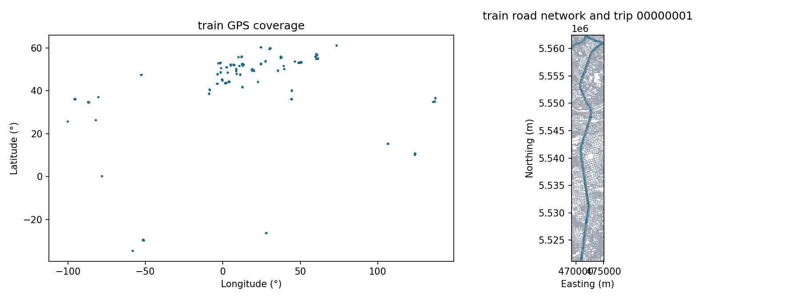

*GPS coordinates, train partition*

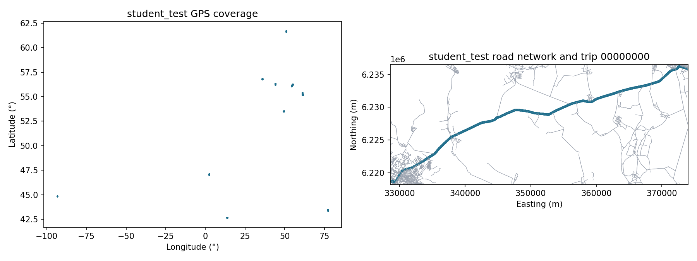

*GPS coordinates, student_test partition*

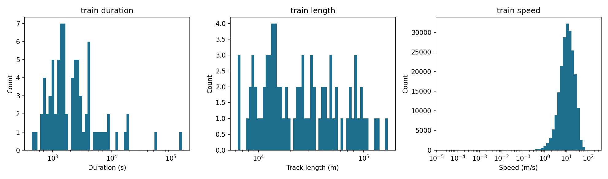

*Trip statistics, train partition*

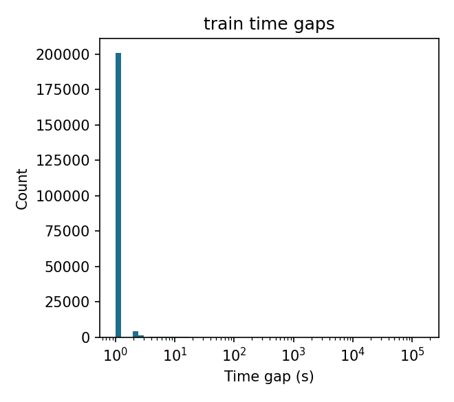

*Time gaps, train partition*

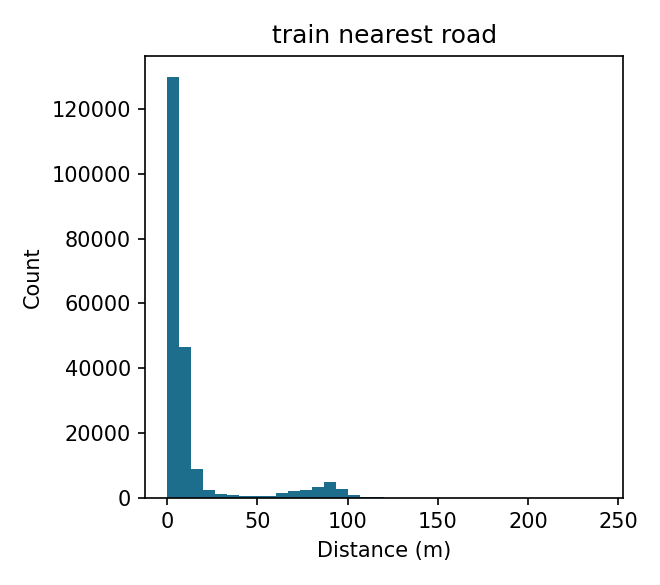

*GPS noise, train partition*

### Road-network visualisations

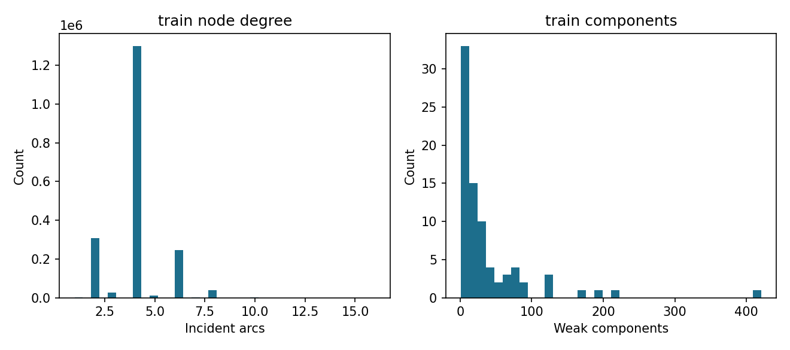

*Road-network size and connectivity, train partition*

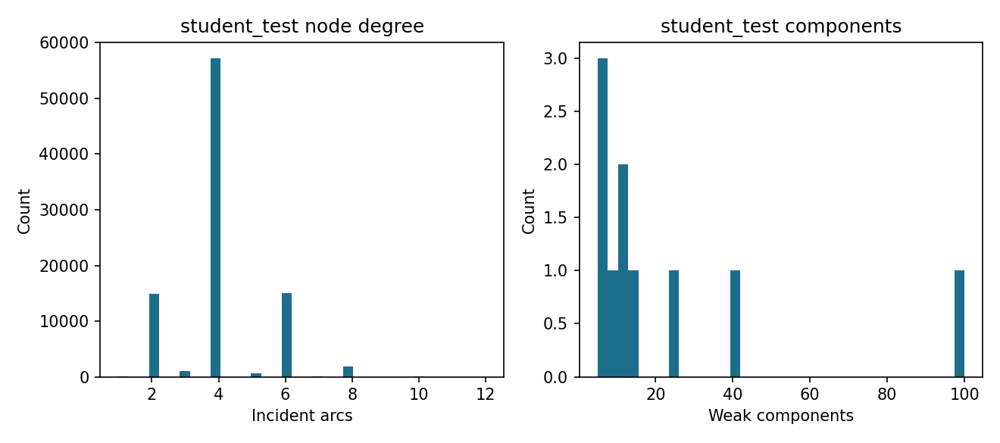

*Road-network size and connectivity, student_test partition*

### Folium map (GPS, road network, reference route)

Interactive maps: `visualisations/maps/eda_train_00000001.html` and `visualisations/maps/eda_student_test_00000007.html` (generated by `python -m visualisations.eda_map`). Insert a screenshot: ``

> **TODO (team):** comment on what the map shows (noise vs road, parallel streets, reference route).  
> *Evidence:* visualisations/maps/eda_*.html

### Reference-label quality, candidate coverage and data-quality decisions

| split | trip_id | n_points | mean_dist_m | p95_dist_m |
|---|---|---|---|---|
| train | 00000002 | 7243 | 33.86 | 242.36 |
| train | 00000033 | 5844 | 81.03 | 142.06 |
| train | 00000043 | 2322 | 18.67 | 70.22 |
| train | 00000054 | 19313 | 134.92 | 210.05 |
| train | 00000066 | 4325 | 33.3 | 65.53 |
| train | 00000081 | 3224 | 10.47 | 44.56 |
| train | 00000084 | 16031 | 10.56 | 36.2 |

| Partition | Candidate miss rate |
|---|---|
| train, all 80 trips | 0.0790 |
| train, trips without flagged labels | 0.0055 |
| train, flagged trips | 0.2682 |
| student_test | 0.0037 |

| K | radius 30 m | radius 60 m | radius 100 m |
|---|---|---|---|
| 8 | 0.0807 | 0.079 | 0.1065 |
| 12 | 0.0719 | 0.0704 | 0.1029 |
| 16 | 0.066 | 0.0647 | 0.1017 |

> **TODO (team):** list the data-quality issues, assumptions and decisions (flagged trips, K and radius choice, treatment of the reference route as reference information, not ground truth).  
> *Evidence:* results/eda/data_quality.md; results/eda/label_quality.csv; results/ablation_flagged_trips.csv

## 3. Model Experimentation and Comparison

### 3.1 Overall Model Comparison

*CV = 5-fold GroupKFold by trip on the 80 train trips; student-test columns use the 10 student_test trips.*

| Model | Algorithm Family | Key Configuration | CV Macro F1 | CV Top-1 | Top-1 Accuracy (student_test) | Route continuity (student_test) | Student-Test Macro F1 | Log Loss (student_test) | Inference Time (ms per 1000 rows) |
|---|---|---|---|---|---|---|---|---|---|
| hist_gradient_boosting | Boosting | HistGradientBoosting(max_iter=150, learning_rate=0.1) | 0.8889 | 0.7432 | 0.8563 | 0.9358 | 0.9163 | 0.1092 | 2.14 |
| random_forest | Ensemble (bagging) | RandomForest(n_estimators=60, max_depth=14, min_samples_leaf=50) | 0.8875 | 0.7426 | 0.8561 | 0.9323 | 0.9151 | 0.1104 | 1.97 |
| decision_tree | Tree-based | DecisionTree(max_depth=12, min_samples_leaf=50) | 0.8750 | 0.7412 | 0.8516 | 0.9337 | 0.9147 | 0.1130 | 0.09 |
| logistic_regression | Linear / probabilistic | StandardScaler + LogisticRegression(C=1.0) | 0.8480 | 0.7308 | 0.8417 | 0.9261 | 0.8926 | 0.1699 | 0.09 |
| gaussian_naive_bayes | Probabilistic (generative) | StandardScaler + GaussianNB | 0.7881 | 0.7169 | 0.8193 | 0.9422 | 0.7953 | 0.4838 | 0.36 |

> **TODO (team):** state the primary selection metric (observation-level Top-1) and why, and which model was chosen.  
> *Evidence:* results/model_comparison.csv; docs/METHODOLOGY.md section 5

### 3.2 Compulsory Questions for EVERY Model

#### Model 1: `hist_gradient_boosting` (Boosting)

*Configuration:* HistGradientBoosting(max_iter=150, learning_rate=0.1)

| Metric | Value |
|---|---|
| CV Top-1 (mean) | 0.7432 |
| CV Top-1 (std over folds) | 0.1717 |
| CV Macro F1 | 0.8889 |
| Student Top-1 | 0.8563 |
| Student Macro F1 | 0.9163 |
| Student precision | 0.8743 |
| Student recall | 0.8426 |
| Student log loss | 0.1092 |
| Student route continuity | 0.9358 |
| Fit time (s) | 6.8 |
| CV time (s) | 40.7 |

**A. Model Understanding**

> **TODO (team):** 1. why this algorithm suits PathSnap (per-candidate probabilities for the decoder).  
> *Evidence:* docs/METHODOLOGY.md section 5

> **TODO (team):** 2. strengths and limitations for this task, connected to the results above.  
> *Evidence:* table above; results/figures/model_confusion_all.png

**B. Training and Configuration**

> **TODO (team):** 5. important hyperparameters and their initial values.  
> *Evidence:* models/train_models.py (model_zoo, hist_gradient_boosting)

> **TODO (team):** 6. loss function / optimisation objective.  
> *Evidence:* models/train_models.py; scikit-learn documentation for this estimator

**C. Experimental Results**

> **TODO (team):** 7. performance on the student-testing dataset.  
> *Evidence:* table above

> **TODO (team):** 8. observation-level Top-1, macro F1 and log loss on student_test.  
> *Evidence:* table above (student rows)

> **TODO (team):** 9. overfitting or underfitting, with evidence (compare CV and student_test, fold std).  
> *Evidence:* CV vs student rows above; results/model_comparison.csv

#### Model 2: `random_forest` (Ensemble (bagging))

*Configuration:* RandomForest(n_estimators=60, max_depth=14, min_samples_leaf=50)

| Metric | Value |
|---|---|
| CV Top-1 (mean) | 0.7426 |
| CV Top-1 (std over folds) | 0.1715 |
| CV Macro F1 | 0.8875 |
| Student Top-1 | 0.8561 |
| Student Macro F1 | 0.9151 |
| Student precision | 0.8905 |
| Student recall | 0.8236 |
| Student log loss | 0.1104 |
| Student route continuity | 0.9323 |
| Fit time (s) | 34.1 |
| CV time (s) | 163.5 |

**A. Model Understanding**

> **TODO (team):** 1. why this algorithm suits PathSnap (per-candidate probabilities for the decoder).  
> *Evidence:* docs/METHODOLOGY.md section 5

> **TODO (team):** 2. strengths and limitations for this task, connected to the results above.  
> *Evidence:* table above; results/figures/model_confusion_all.png

**B. Training and Configuration**

> **TODO (team):** 5. important hyperparameters and their initial values.  
> *Evidence:* models/train_models.py (model_zoo, random_forest)

> **TODO (team):** 6. loss function / optimisation objective.  
> *Evidence:* models/train_models.py; scikit-learn documentation for this estimator

**C. Experimental Results**

> **TODO (team):** 7. performance on the student-testing dataset.  
> *Evidence:* table above

> **TODO (team):** 8. observation-level Top-1, macro F1 and log loss on student_test.  
> *Evidence:* table above (student rows)

> **TODO (team):** 9. overfitting or underfitting, with evidence (compare CV and student_test, fold std).  
> *Evidence:* CV vs student rows above; results/model_comparison.csv

#### Model 3: `decision_tree` (Tree-based)

*Configuration:* DecisionTree(max_depth=12, min_samples_leaf=50)

| Metric | Value |
|---|---|
| CV Top-1 (mean) | 0.7412 |
| CV Top-1 (std over folds) | 0.1716 |
| CV Macro F1 | 0.8750 |
| Student Top-1 | 0.8516 |
| Student Macro F1 | 0.9147 |
| Student precision | 0.8856 |
| Student recall | 0.8269 |
| Student log loss | 0.1130 |
| Student route continuity | 0.9337 |
| Fit time (s) | 15.0 |
| CV time (s) | 50.8 |

**A. Model Understanding**

> **TODO (team):** 1. why this algorithm suits PathSnap (per-candidate probabilities for the decoder).  
> *Evidence:* docs/METHODOLOGY.md section 5

> **TODO (team):** 2. strengths and limitations for this task, connected to the results above.  
> *Evidence:* table above; results/figures/model_confusion_all.png

**B. Training and Configuration**

> **TODO (team):** 5. important hyperparameters and their initial values.  
> *Evidence:* models/train_models.py (model_zoo, decision_tree)

> **TODO (team):** 6. loss function / optimisation objective.  
> *Evidence:* models/train_models.py; scikit-learn documentation for this estimator

**C. Experimental Results**

> **TODO (team):** 7. performance on the student-testing dataset.  
> *Evidence:* table above

> **TODO (team):** 8. observation-level Top-1, macro F1 and log loss on student_test.  
> *Evidence:* table above (student rows)

> **TODO (team):** 9. overfitting or underfitting, with evidence (compare CV and student_test, fold std).  
> *Evidence:* CV vs student rows above; results/model_comparison.csv

#### Model 4: `logistic_regression` (Linear / probabilistic)

*Configuration:* StandardScaler + LogisticRegression(C=1.0)

| Metric | Value |
|---|---|
| CV Top-1 (mean) | 0.7308 |
| CV Top-1 (std over folds) | 0.1688 |
| CV Macro F1 | 0.8480 |
| Student Top-1 | 0.8417 |
| Student Macro F1 | 0.8926 |
| Student precision | 0.8429 |
| Student recall | 0.7941 |
| Student log loss | 0.1699 |
| Student route continuity | 0.9261 |
| Fit time (s) | 1.0 |
| CV time (s) | 5.0 |

**A. Model Understanding**

> **TODO (team):** 1. why this algorithm suits PathSnap (per-candidate probabilities for the decoder).  
> *Evidence:* docs/METHODOLOGY.md section 5

> **TODO (team):** 2. strengths and limitations for this task, connected to the results above.  
> *Evidence:* table above; results/figures/model_confusion_all.png

**B. Training and Configuration**

> **TODO (team):** 5. important hyperparameters and their initial values.  
> *Evidence:* models/train_models.py (model_zoo, logistic_regression)

> **TODO (team):** 6. loss function / optimisation objective.  
> *Evidence:* models/train_models.py; scikit-learn documentation for this estimator

**C. Experimental Results**

> **TODO (team):** 7. performance on the student-testing dataset.  
> *Evidence:* table above

> **TODO (team):** 8. observation-level Top-1, macro F1 and log loss on student_test.  
> *Evidence:* table above (student rows)

> **TODO (team):** 9. overfitting or underfitting, with evidence (compare CV and student_test, fold std).  
> *Evidence:* CV vs student rows above; results/model_comparison.csv

#### Model 5: `gaussian_naive_bayes` (Probabilistic (generative))

*Configuration:* StandardScaler + GaussianNB

| Metric | Value |
|---|---|
| CV Top-1 (mean) | 0.7169 |
| CV Top-1 (std over folds) | 0.1647 |
| CV Macro F1 | 0.7881 |
| Student Top-1 | 0.8193 |
| Student Macro F1 | 0.7953 |
| Student precision | 0.5441 |
| Student recall | 0.8880 |
| Student log loss | 0.4838 |
| Student route continuity | 0.9422 |
| Fit time (s) | 0.4 |
| CV time (s) | 3.7 |

**A. Model Understanding**

> **TODO (team):** 1. why this algorithm suits PathSnap (per-candidate probabilities for the decoder).  
> *Evidence:* docs/METHODOLOGY.md section 5

> **TODO (team):** 2. strengths and limitations for this task, connected to the results above.  
> *Evidence:* table above; results/figures/model_confusion_all.png

**B. Training and Configuration**

> **TODO (team):** 5. important hyperparameters and their initial values.  
> *Evidence:* models/train_models.py (model_zoo, gaussian_naive_bayes)

> **TODO (team):** 6. loss function / optimisation objective.  
> *Evidence:* models/train_models.py; scikit-learn documentation for this estimator

**C. Experimental Results**

> **TODO (team):** 7. performance on the student-testing dataset.  
> *Evidence:* table above

> **TODO (team):** 8. observation-level Top-1, macro F1 and log loss on student_test.  
> *Evidence:* table above (student rows)

> **TODO (team):** 9. overfitting or underfitting, with evidence (compare CV and student_test, fold std).  
> *Evidence:* CV vs student rows above; results/model_comparison.csv

### 3.3 Model Visualisations

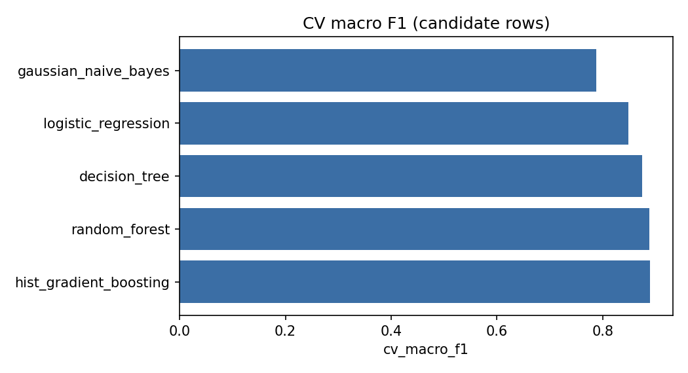

*Cross-validation macro F1 across models*

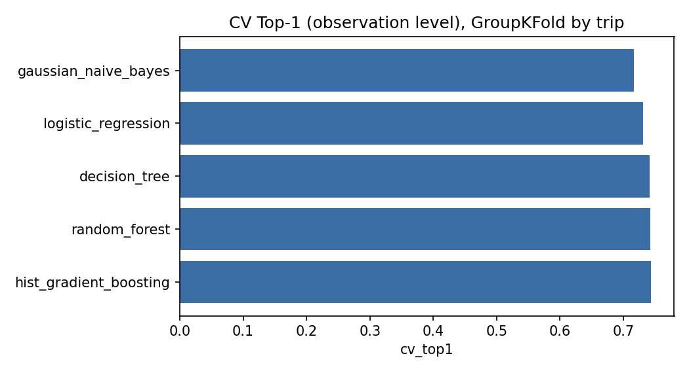

*Cross-validation Top-1 across models*

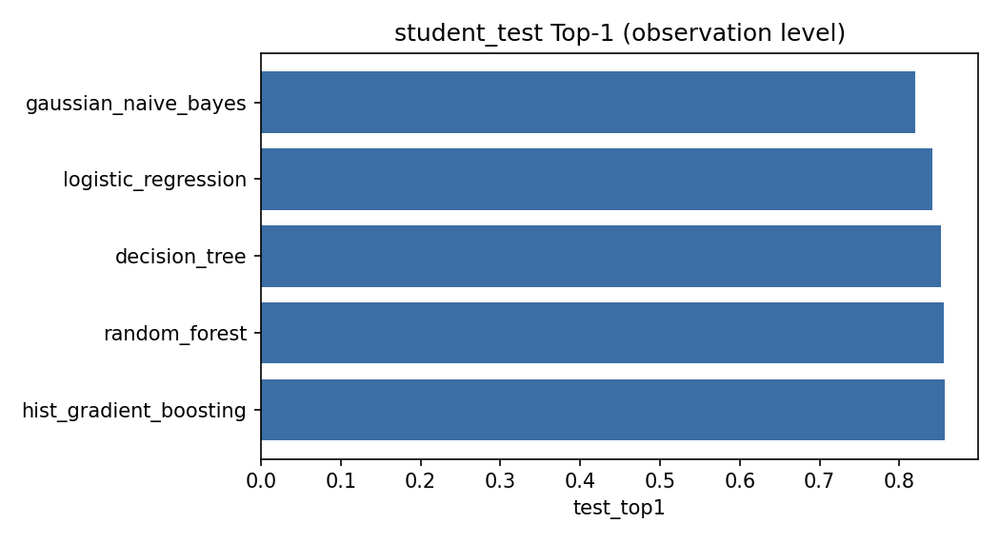

*student_test Top-1 across models*

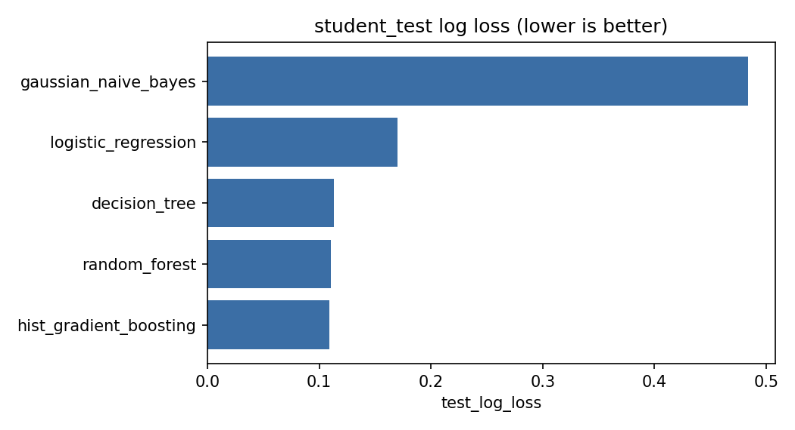

*student_test log loss across models*

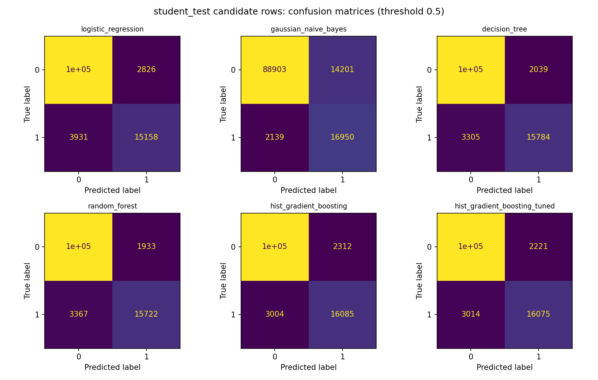

*Confusion matrices on student_test candidate rows*

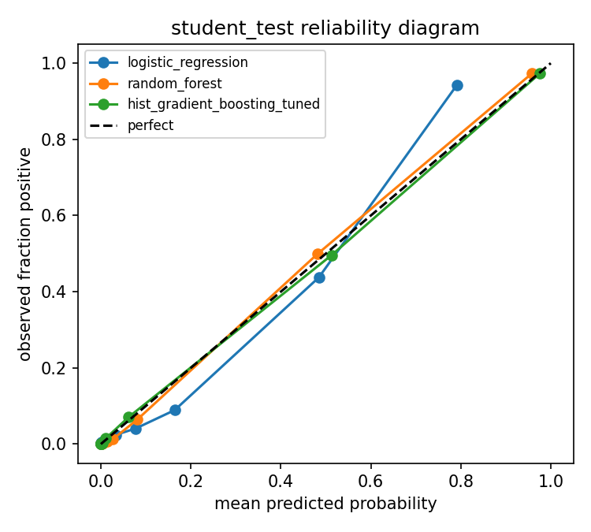

*Reliability diagram on student_test*

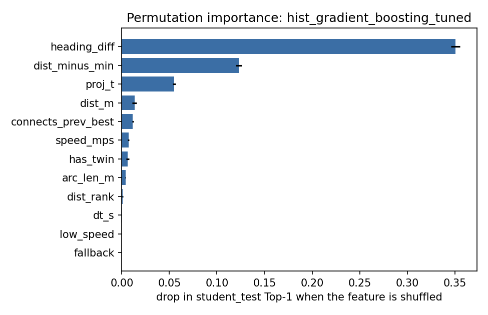

*Permutation importance of the selected model*

> **TODO (team):** explain why training/validation loss curves are N/A for these models (no epoch-wise history), and use the plots to justify the model selection.  
> *Evidence:* results/figures/model_*.png

Folium map of a selected trip: see section 6.

## 4. Bayesian Hyperparameter Optimisation (for the chosen model)

| Item | Value |
|---|---|
| Model tuned | hist_gradient_boosting |
| Sampler | TPE |
| Trials | 20 |
| Folds per trial | 3 |
| Trips in the search sample | 36 |
| Objective | mean observation-level Top-1 |
| Best objective (search sample) | 0.8494 |
| Search time (s) | 555 |
| Seed | 42 |
| Selected for deployment | hist_gradient_boosting_tuned |

> **TODO (team):** 1. which hyperparameters were searched.  
> *Evidence:* optimisation/bayes_tune.py (suggest)

> **TODO (team):** 2. ranges / distributions considered and why.  
> *Evidence:* optimisation/bayes_tune.py (suggest)

> **TODO (team):** 3. objective function optimised and why.  
> *Evidence:* artifacts/best_params.json; docs/METHODOLOGY.md section 5

> **TODO (team):** 4. number of trials performed.  
> *Evidence:* table above; results/optuna_trials.csv

> **TODO (team):** 5. best hyperparameter values obtained.  
> *Evidence:* table below; artifacts/best_params.json

| Hyperparameter | Best value |
|---|---|
| learning_rate | 0.09304854626697996 |
| max_iter | 189.0 |
| max_leaf_nodes | 50.0 |
| min_samples_leaf | 181.0 |
| l2_regularization | 0.0001601173409473354 |

Top 5 trials:

| number | value | params_l2_regularization | params_learning_rate | params_max_iter | params_max_leaf_nodes | params_min_samples_leaf |
|---|---|---|---|---|---|---|
| 17 | 0.8494 | 0.0002 | 0.093 | 189 | 50 | 181 |
| 15 | 0.8488 | 0.0155 | 0.1103 | 199 | 55 | 159 |
| 13 | 0.8487 | 0.0002 | 0.0997 | 209 | 57 | 186 |
| 11 | 0.8487 | 0.0037 | 0.0887 | 214 | 61 | 152 |
| 0 | 0.8486 | 0.0006 | 0.0551 | 241 | 50 | 128 |

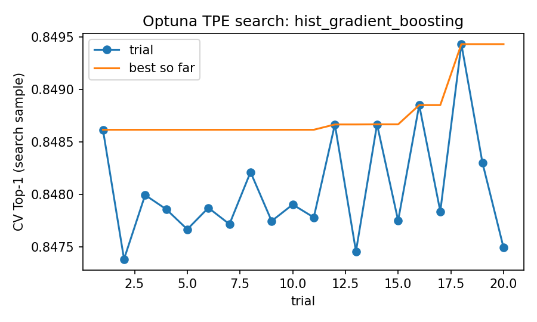

*Optuna search history*

> **TODO (team):** 6. did the tuned model outperform the untuned model? (same metrics, same partitions)  
> *Evidence:* tuned-vs-untuned table below

### Tuned vs untuned (same folds and partitions)

| Configuration | CV Macro F1 | CV Top-1 | Student-Test Top-1 | Student-Test Macro F1 | Log Loss (student_test) | Inference Time (ms per 1000 rows) |
|---|---|---|---|---|---|---|
| untuned | 0.8889 | 0.7432 | 0.8563 | 0.9163 | 0.1092 | 2.14 |
| tuned (Optuna TPE) | 0.8888 | 0.7443 | 0.8586 | 0.9173 | 0.1075 | 4.87 |

> **TODO (team):** discuss the size of the difference relative to fold-to-fold variation, and the computational cost.  
> *Evidence:* results/tuning_comparison.csv; results/model_comparison.csv (cv_top1_std)

## 5. HMM and Viterbi Route Reconstruction

> **TODO (team):** 1. what are the hidden states (candidate arcs per GPS point).  
> *Evidence:* docs/METHODOLOGY.md section 6

> **TODO (team):** 2. how emission probabilities are calculated (classifier probability x distance Gaussian, weight w).  
> *Evidence:* hmm/emission.py; artifacts/hmm_config.json

> **TODO (team):** 3. how transition probabilities are calculated (directed road-graph hops, U-turn, epsilon).  
> *Evidence:* hmm/transition.py; artifacts/hmm_config.json

> **TODO (team):** 4. how missing candidates and large GPS gaps are handled.  
> *Evidence:* hmm/decode.py; hmm/transition.py (gap_s, gap_extra_hops)

> **TODO (team):** 5. what happens when consecutive observations suggest disconnected segments (epsilon floor; report its usage share).  
> *Evidence:* table below (epsilon-transition share)

> **TODO (team):** write the Viterbi recurrence and explain why log space and the T x K^2 cost.  
> *Evidence:* hmm/viterbi.py; tests/test_viterbi.py (hand-checked example)

### Decoder parameters (artifacts)

| Parameter | Classifier + HMM | Distance-only HMM |
|---|---|---|
| w | 0.3 | 0.0 |
| sigma_m | 20.0 | 12.0 |
| heading_sigma_deg | 45.0 | 45.0 |
| heading_weight | 0.0 | 0.0 |
| same | 0.8 | 0.6 |
| succ | 0.3 | 0.3 |
| hop2 | 0.05 | 0.05 |
| hop3 | 0.02 | 0.02 |
| uturn | 0.01 | 0.01 |
| eps | 1e-06 | 1e-08 |
| gap_s | 20.0 | 20.0 |
| gap_extra_hops | 3.0 | 3.0 |

### Decoder tuning: best value per parameter (train out-of-fold sample)

| param | value | top1 | continuity |
|---|---|---|---|
| eps | 0.0 | 0.9355 | 0.9802 |
| gap_s | 5.0 | 0.9355 | 0.9802 |
| same | 0.8 | 0.9355 | 0.9802 |
| sigma_m | 8.0 | 0.9341 | 0.9801 |
| succ | 0.3 | 0.9355 | 0.9802 |
| uturn | 0.0001 | 0.9355 | 0.9802 |
| w | 0.3 | 0.9341 | 0.9801 |

### Classifier-only vs classifier + HMM (student_test)

| Method | Top-1 | Macro F1 | Route continuity | Wrong-direction rate | Trips >= 90% correct | Epsilon-transition share | Decode s/trip |
|---|---|---|---|---|---|---|---|
| nearest_arc | 0.5395 | 0.7227 | 0.8201 | 0.3506 | 0% | - | 0.00 |
| classifier_only(model) | 0.8586 | 0.9176 | 0.9370 | 0.0658 | 40% | - | 0.01 |
| classifier_only(alt) | 0.8561 | 0.9161 | 0.9323 | 0.0653 | 40% | - | 0.00 |
| hmm_distance | 0.9300 | 0.9602 | 0.9949 | 0.0279 | 70% | 0.0008 | 0.32 |
| hmm_classifier(model) | 0.9314 | 0.9609 | 0.9854 | 0.0360 | 80% | 0.0008 | 0.41 |
| hmm_classifier(alt) | 0.9395 | 0.9656 | 0.9874 | 0.0245 | 80% | 0.0008 | 0.40 |

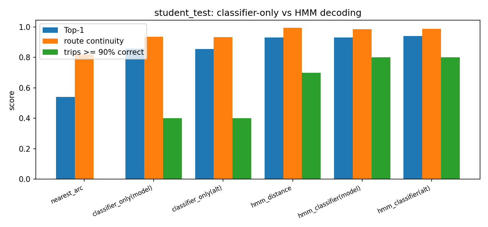

*Classifier-only vs HMM decoding on student_test*

> **TODO (team):** 6. did HMM decoding improve the final route? support with the table (Top-1, continuity, trips >= 90%, wrong-direction rate).  
> *Evidence:* results/hmm_results.csv; results/hmm_per_trip.csv

### Per-trip Top-1

| trip | classifier_only(alt) | classifier_only(model) | hmm_classifier(alt) | hmm_classifier(model) | hmm_distance | nearest_arc |
|---|---|---|---|---|---|---|
| 00000000 | 0.938 | 0.941 | 0.969 | 0.968 | 0.969 | 0.545 |
| 00000007 | 0.923 | 0.928 | 0.993 | 0.994 | 0.993 | 0.453 |
| 00000009 | 0.866 | 0.867 | 0.91 | 0.914 | 0.871 | 0.537 |
| 00000040 | 0.923 | 0.924 | 0.98 | 0.98 | 0.992 | 0.548 |
| 00000052 | 0.958 | 0.966 | 0.996 | 0.989 | 0.954 | 0.771 |
| 00000056 | 0.889 | 0.891 | 0.954 | 0.959 | 0.923 | 0.691 |
| 00000065 | 0.833 | 0.832 | 0.879 | 0.876 | 0.839 | 0.689 |
| 00000076 | 0.859 | 0.865 | 0.958 | 0.961 | 0.935 | 0.417 |
| 00000077 | 0.69 | 0.693 | 0.867 | 0.821 | 0.874 | 0.403 |
| 00000091 | 0.855 | 0.855 | 0.932 | 0.935 | 0.924 | 0.564 |

### Failure cases (trips where the HMM improved Top-1 least)

| trip | points | top1_loss_vs_classifier_only | disagreement_point_ranges |
|---|---|---|---|
| 00000052 | 262 | -0.0229 | 52-55; 5-6; 23-23; 17-17 |
| 00000000 | 2503 | -0.0272 | 2454-2468; 2479-2484; 2491-2495; 2200-2204; 2090-2094 |
| 00000065 | 768 | -0.0443 | 239-242; 735-737; 722-724; 136-138; 690-691 |

> **TODO (team):** discuss cases where HMM decoding did not help (open the trips on the map; compare with the distance-only HMM).  
> *Evidence:* results/hmm_failures.csv; visualisations/maps/pred_<trip>.html

## 6. Geographical Visualisation Using Folium

Maps are generated by `python -m visualisations.plot_prediction` (predictions) and `python -m visualisations.eda_map` (EDA). Layers: GPS observations, road network, reference route, predicted route, with a legend and layer control.

| Trip | Interactive map |
|---|---|
| 00000000 | visualisations/maps/pred_00000000.html |
| 00000007 | visualisations/maps/pred_00000007.html |
| 00000009 | visualisations/maps/pred_00000009.html |
| 00000040 | visualisations/maps/pred_00000040.html |
| 00000052 | visualisations/maps/pred_00000052.html |
| 00000056 | visualisations/maps/pred_00000056.html |
| 00000065 | visualisations/maps/pred_00000065.html |
| 00000076 | visualisations/maps/pred_00000076.html |
| 00000077 | visualisations/maps/pred_00000077.html |
| 00000091 | visualisations/maps/pred_00000091.html |

Insert at least one exported view of an interactive map: `` (save it in `report/screenshots/`).

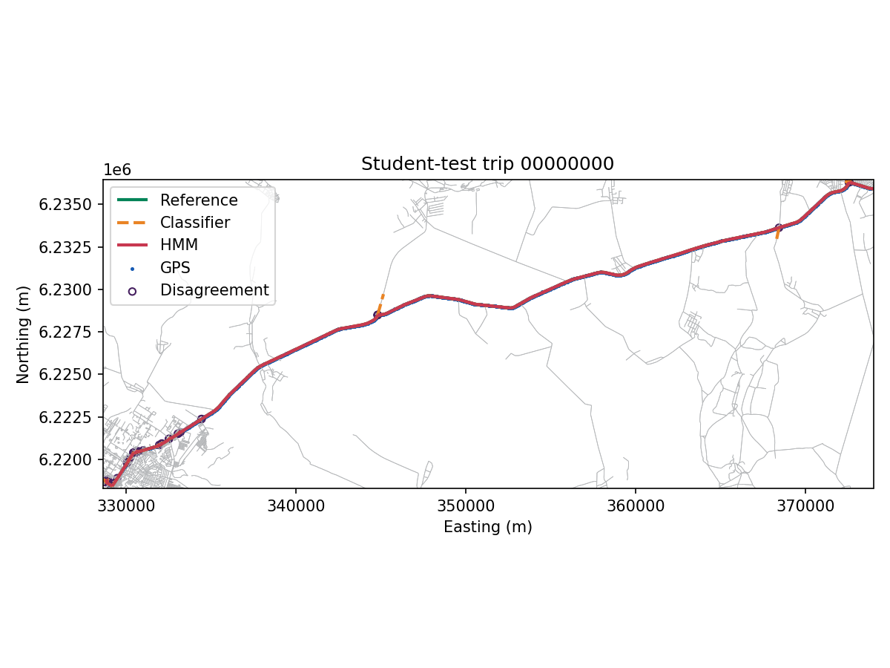

*Reference (green), classifier-only (orange), HMM (red), GPS (blue): trip 00000000*

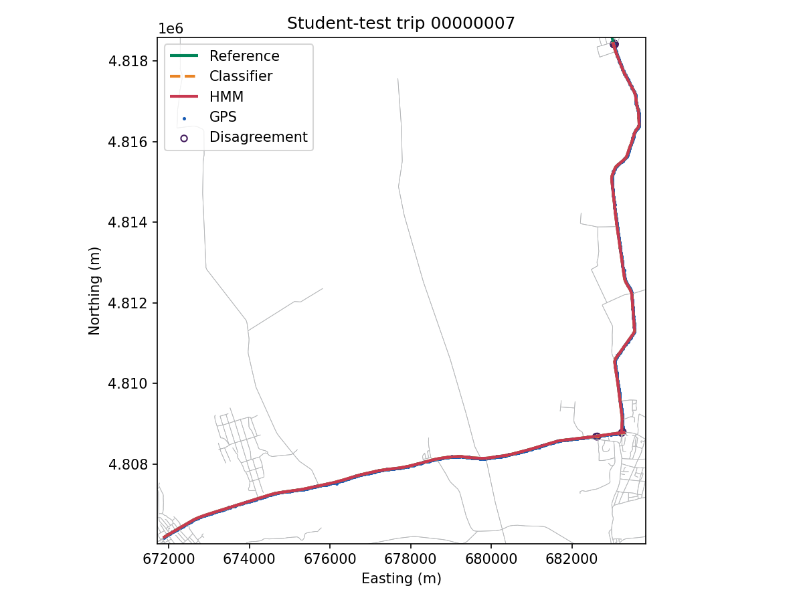

*Reference (green), classifier-only (orange), HMM (red), GPS (blue): trip 00000007*

> **TODO (team):** explain how to read the map and what it shows about where the HMM corrects the classifier.  
> *Evidence:* visualisations/maps/pred_<trip>.html

## 7. API, UI and Deployment

### Endpoints

| Endpoint | Purpose |
|---|---|
| GET /health | liveness |
| GET /trips | ids of the evaluation trips (data/eval_test/) |
| POST /predict | predict one trip; returns points, route_coords, accuracy, route_continuity, latency_ms, model_version |

> **TODO (team):** explain the prediction flow (features, classifier, Viterbi) and how model, features and decoder config are loaded once at start-up.  
> *Evidence:* api/main.py; hmm/pipeline.py

> **TODO (team):** explain how ground truth stays server-side (evaluation after prediction, only two numbers returned) and how this is tested.  
> *Evidence:* api/evaluation.py; tests/test_pipeline.py; tests/test_api.py; tests/test_ui_contract.py

### Screenshots (captured on the real two-laptop run, saved in `report/screenshots/`)

1. Working UI after a prediction: ``

2. API request log on the receiving laptop (Laptop 1): ``

> **TODO (team):** describe the deployment (which laptop runs what, addresses, firewall) and the commands used.  
> *Evidence:* README.md quick start; scripts/start_api.ps1; scripts/start_ui.ps1

> **TODO (team):** state that the submitted code matches the implementation demonstrated.  
> *Evidence:* repository at the submitted commit

## 8. AI Usage

> **TODO (team):** disclose AI assistance as required by the event policy: what tools were used for what, and what the team verified.  
> *Evidence:* AI_USAGE.md
